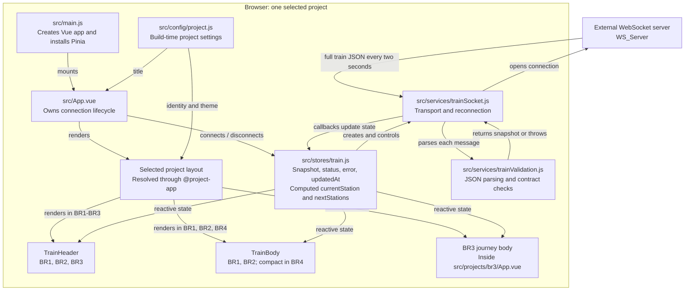
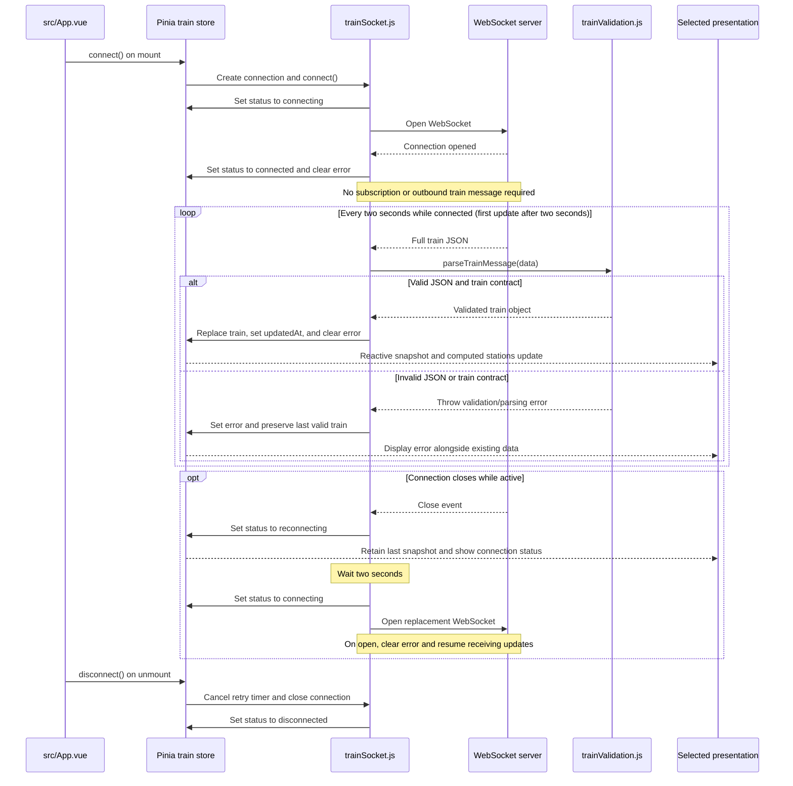
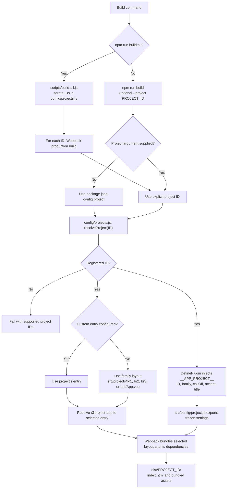

# Multi-project Vue application

One source tree, shared Pinia stores, and a presentation selected at build time.

## Select a project

The global default is `config.project` in `package.json`:

```json
"config": {
  "project": "BR1_START"
}
```

Run `npm run dev`, `npm run build`, or `npm run preview` to use that default.
The preview command requires an existing build for the selected project.

Override the default for a single command using the project flag:

```sh
npm run dev -- --project BR1_METRO
npm run build -- --project BR2_SRM
npm run preview -- --project BR2_SRM
```

Project IDs are case-sensitive. Without `--project`, commands use `config.project`.
Webpack uses development mode for `dev` and production mode for builds;
the project ID is independent of that mode.
An unknown project fails immediately with the list of supported IDs.

The development server runs at `http://127.0.0.1:5173` with Vue hot reload.
Preview serves the selected build at `http://127.0.0.1:4173` without compiling.
Both accept `--host` and `--port`, for example:

```sh
npm run dev -- --project BR3_AGAM --host 0.0.0.0 --port 5174
```

| Family | Available project IDs |
| --- | --- |
| BR1 | `BR1_START`, `BR1_METRO` |
| BR2 | `BR2_SRM`, `BR2_ENOE` |
| BR3 | `BR3_AGAM`, `BR3_CONVERGENCE`, `BR3_ONIT` |
| BR4 | `BR4_SBR`, `BR4_DT6` |

Build every registered project with `npm run build:all`. New entries in
`config/projects.js` are included automatically.

Build artifacts go to `dist/<PROJECT_ID>/`, for example `dist/BR2_SRM/`.
Deploy the contents of that folder. Building another project preserves previous
projects' output folders. The selector is fixed at build time: switching an
already deployed app requires building and deploying the other project.

## Source organization

```text
config/projects.js       Registry of families, call-offs, and presentation settings
config/selection.js      Shared project selection and default resolution
config/environment.js    Environment loading and variable expansion
webpack.config.js        Vue compilation, aliases, environment, and asset output
scripts/run.js           Development, build, and preview commands
scripts/build-all.js     Sequential builds of all registered projects
src/config/project.js    Selected project's settings, available to application code
src/stores/              Shared Pinia state and data logic
src/components/          Components reusable by any project
src/projects/br1/App.vue BR1 layout shared by Start and Metro
src/projects/br2/App.vue BR2 layout shared by SRM and ENOE
src/projects/br3/App.vue BR3 layout shared by AGAM, Convergence, and Onit
src/projects/br4/App.vue BR4 layout shared by SBR and DT6
src/App.vue              Mounts the selected project layout
```

Webpack resolves `@project-app` directly to the selected layout. Other family
layouts are not imported into that build. Call-offs within a family share the
layout and vary through `project` settings. The starter examples vary their
name and accent color; replace these examples with your actual presentation.

Read the selected settings in any component:

```js
import { project } from '@/config/project'
// project.id, project.family, project.callOff, project.title, project.accent
```

Keep state and data behavior in `src/stores`, and import the same stores from
any presentation. All builds use the same store implementation and initial data.
Independent deployments have independent in-memory state; each deployment receives train updates from its configured WebSocket server.

## Add or customize a call-off

Add an entry in `config/projects.js` with its family, call-off name, and settings.
It inherits its family's layout by default. For a completely different layout,
set an optional `entry`, relative to the repository root:

```js
BR1_START: {
  family: 'BR1',
  callOff: 'Start',
  accent: '#2563eb',
  entry: './src/projects/br1/start/App.vue',
},
```

Create that component and reuse shared stores and components as needed.
To add a family, add its layout to `families` in the same registry.

## Setup

Use the Node version specified by `engines` in `package.json`, then run:

```sh
npm install
npm run dev
```

`npm run build:all` verifies compilation of every variant.

## Train WebSocket data

The shared `train` Pinia store receives the server's train updates. BR1, BR2, and
BR4 use the shared `TrainBody` component; BR1–BR3 use `TrainHeader`. BR3 has its
own journey body using the same store. Connection ownership belongs to the root
`src/App.vue`: it connects on mount and disconnects on unmount.

- `src/services/trainSocket.js`: WebSocket connection, JSON parsing, validation,
  and reconnection after two seconds when the connection closes.
- `src/services/trainValidation.js`: validates the contract in
  `../WS_Server/schemas/train.schema.json`, including required fields and rejection
  of extra properties. Update this validator when the schema changes.
- `src/stores/train.js`: latest valid `train`, connection `status`, `error`, and
  `updatedAt` (local reception time in ISO format), plus `connect`/`disconnect`.

The contract in `../WS_Server/asyncapi.yaml` specifies server-to-client updates:
one full JSON train object every two seconds, with the first arriving two seconds
after connection. No subscription or outbound train message is required. Each
valid message replaces the previous train snapshot. Invalid messages report an
error and leave the last valid snapshot intact. Reconnection also preserves the
last snapshot; data is held in memory and resets on a page reload.

The default endpoint is `ws://localhost:8080/`. To override it, copy `.env.example`
to `.env.local` and change `WS_URL`, then restart the dev server or rebuild. Webpack embeds
this URL at build time. Use `wss://` when serving the frontend over HTTPS.
For deployed apps, use an address reachable by the user's browser; `localhost`
refers to the browser's own machine.

Environment files load in this order, with later files taking precedence:
`.env`, `.env.local`, `.env.<PROJECT_ID>`, `.env.<PROJECT_ID>.local`.
Existing process environment values take precedence over files. Variable
expansion is supported. Only the resolved WebSocket URL is exposed to application
code as `__TRAIN_WS_URL__`; other environment values are not bundled automatically.
The previous `VITE_WS_URL` name is accepted as a fallback for existing local
configuration; use `WS_URL` for new configuration.

Start the sibling example server in a separate terminal:

```sh
cd ../WS_Server
npm start
```

Then run this app with `npm run dev`. Consume the shared data in any presentation:

```js
import { useTrainStore } from '@/stores/train'
const trainStore = useTrainStore()
// trainStore.train?.TrainDestination
// trainStore.train?.CurrentStation
// trainStore.train?.ListOfStations
```

## Train presentation

`TrainHeader` shows the train type and number, destination, and the browser's
current local time in 24-hour `HH:MM` format. The clock updates independently
of incoming WebSocket messages and stops its timer when unmounted.

`TrainBody` highlights the current station name, type, arrival, and departure.
Below it, a smaller table displays up to four stations following the current
station in route order. The shared store exposes `currentStation` and
`nextStations` for reuse by other presentations. It matches all current-station
fields first, falling back to the station name if timetable details differ.
If the current station is absent from the list, or it is the final stop,
no upcoming stations are shown. Empty arrival/departure values appear as `—`.

All project layouts use a fixed 1920 × 1080 CSS-pixel canvas, including padding
and borders. Smaller browser windows scroll rather than scaling the layout.

Both BR4 variants omit the header and use a compact `TrainBody`: a small current
station section showing only its name, followed by up to three upcoming station
names without arrival or departure times. The larger right-hand area is an empty
advertising placeholder.

BR3 uses a journey display with a prominent current station, arrival and departure
times, a destination card, and a vertical route timeline showing up to four
upcoming stops. The next stop is highlighted. AGAM uses ivory and amber,
Convergence uses a dark rose theme, and Onit uses a light violet theme. The header
retains the train identity, destination, and live local clock. A footer reports
connection state and errors; the last received journey remains visible during
reconnection. Before the first update, a welcome panel waits for live data.

## Architecture

This diagram separates the browser application from the external train server.
Arrows describe mounting, rendering, service calls, and data updates. Each build
includes one selected project layout; the BR-specific branches show which
presentation components that layout uses.



## Train-update sequence

The root component owns the connection. Valid messages replace the complete
snapshot; invalid messages only update the error. The clock in `TrainHeader`
runs independently of this sequence.



If constructing the WebSocket throws, the service sets status to `error` and
reports the exception without scheduling a retry. A WebSocket error event
reports an error; a subsequent close event triggers the reconnection path above.

## Build selection

Selection happens in `webpack.config.js` using `config/selection.js` before the
application is bundled.
`build:all` invokes the same build pipeline sequentially for every registered
project ID. This diagram describes builds; dev and preview use the same selector,
but preview serves an existing build.



Other family layouts are excluded from that project's bundle. Switching the
deployed presentation requires building and deploying the other project.
